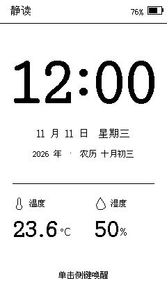
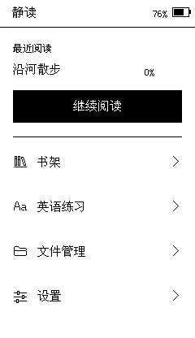
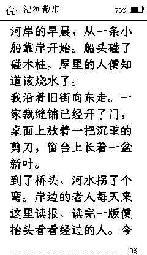
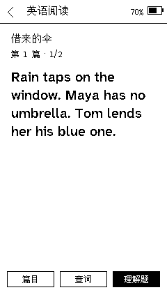

# 静读

为武哒哒 WDD 2026V1 做的一套小屏阅读固件。3.7 英寸黑白墨水屏、一枚侧键：拿起接着读，放下看时间。书籍、英语课包和离线词典都放在自己的 TF 卡上。

<a href="docs/ui/design/index.html#lock"></a>
<a href="docs/ui/design/index.html#home"></a>
<a href="docs/ui/design/index.html#book"></a>
<a href="docs/ui/design/index.html#passage"></a>

**锁屏时钟 · 首页与续读 · 中文阅读 · 英语练习**　四图均为当前固件的桌面绘图输出，原图每张 240 × 416。想看设备实际输出，请看配有实机回读图的[完整功能指南](docs/guides/完整功能指南.md)；想试操作，可下载后打开[全页面交互设计稿](docs/ui/design/index.html)。

- **读书。** 支持 TXT 和可重排 EPUB、中文字体与字号、章节目录、书签和进度跳转。[阅读操作](docs/guides/完整功能指南.md#reading)
- **学英语。** 读长短句、做理解题、用词典查词、复习生词和错题，支持自己导入课包。[英语练习](docs/guides/完整功能指南.md#english) · [资料导入](docs/guides/使用与导入.md)
- **连到局域网。** 手机或电脑可以向 TF 卡传书、字体和课包；也可以给无线墨屏投送文字或整幅黑白图。[文件服务](docs/guides/完整功能指南.md#network) · [无线墨屏](docs/guides/完整功能指南.md#cast)

当前版本为 **0.2.19**。TXT 首次开书会显示章节目录的整理进度，中途返回后可以续建。目录存到 TF 卡后才进入正文。再次开书可直接续读，打开目录会定位到正在读的章节。[读第一本书](docs/guides/完整功能指南.md#library) · [24,001 章实机示例](docs/guides/完整功能指南.md#large-toc)

## 从源码构建

已安装的固件版本可在阅读器的「设置 → 关于静读 → 系统版本」查看。

在仓库根目录运行：

```sh
./scripts/build.sh
```

桌面回归使用 `./tests/run.sh`。板端构建后运行 `python3 scripts/package.py`，在 `artifacts/` 得到应用镜像、随卡 ZIP 和 SHA256SUMS。ZIP 解到 TF 卡根目录。[环境与验证命令](docs/development/构建与验证.md) · [机型与分区](docs/hardware/WDD-2026V1.md)

二次开发从[工程规范](docs/development/工程目录与编码规范.md)、[智能体协作说明](AGENTS.md)和[文档索引](docs/README.md)开始。第三方组件、字体和随卡资料分别保留其来源与许可。[第三方声明](licenses/NOTICE) · [随卡资料来源](tf/资料来源/来源.md)
