# 静读完整功能指南

静读把这块 3.7 英寸墨水屏当作一本随身的小书：读书时用两侧翻页，偶尔要用的工具收在中央菜单里。插入 TF 卡即可读书、做英语练习和查词；只有传文件、投送画面和联网校时需要 Wi-Fi。本文对应静读 **0.2.19**，适用机型为 WDD 2026V1。

[读第一本书](#library) · [翻页与书签](#reading) · [字体与排版](#layout) · [英语练习](#english) · [查词与复习](#words) · [联网传文件](#network) · [无线墨屏](#cast) · [时钟与电源](#device) · [存档与故障提示](#recovery)

下文标「面板实拍」的照片展示机身和墨水屏上的实际字形。其余标「实机」的图通过 USB 读回，保留屏幕原生 **240 × 416** 黑白像素，图注标有固件版本或采集时间。回读图适合核对内容和按钮位置，不能反映屏幕残影、前光或刷新耗时。要试一个暂未配实机图的页面，请在本地打开[全页面交互设计稿](../ui/design/index.html)；它使用示例资料，不会改动设备。

## 第一次使用：从首页到第一本书

<!-- views: Home Shelf Files File -->

把随卡 ZIP 解到 TF 卡根目录，让卡上直接出现 `books`、`fonts`、`courses` 和 `dictionaries`。插卡后，首页上半部是「最近阅读」，下面依次是书架、英语练习、文件管理和设置。

1. **直接读。** 首页还没有最近阅读时，点「从 TF 卡选书」。有 `/books` 就从这里开始，没有则从根目录开始。选一本 TXT 或 EPUB，在文件详情点「打开阅读」。
2. **收进书架。** 从「书架 → 添加」选书，再点「加入书架」。收录的是原文件位置，不会再复制一份。书架显示各书进度；列表超过一屏，用页脚翻页。
3. **下次接着读。** 回到首页点「继续阅读」，直接回到这张卡上上次显示的位置。换一张新卡，首页不会带出原卡的书。
4. **浏览其他目录。** 「文件管理」可进入卡上其他普通目录。点文件夹进入，左上返回原目录；点书籍可打开或加入书架。其他文件的改名、下载、删除在浏览器文件服务中进行。

**首次打开 TXT** 会先核对书籍版本，再整理完整的章节目录。按已扫描原文字节显示进度。中途点「返回」回到选书入口，下次从最近保存的完整行继续。目录写入成功后才进入阅读，重开同版本的书直接使用卡上目录。扫描完没有章标题也可以阅读。TF 卡写入失败时，检查卡后再重开。

**桌面示例 · 0.2.19**。进度按已经扫描的正文计算，屏幕上的「返回」可中断整理。

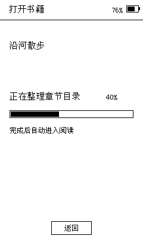

| 无卡首页 · 实机 0.2.19 | 存储卡已挂载 · 实机 0.2.10 |
| --- | --- |
| 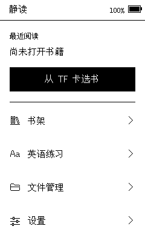 |  |

## 读书：翻页、目录、书签与进度

<!-- views: Book Menu Toc Marks RemoveMark Jump -->

默认点正文右侧下一页、左侧上一页；单击侧键也能向后翻。**点正文中央打开阅读菜单**，左上返回正文。正文左上角的小房子直接回首页。正文底部只有细进度条和百分比；这里没有按钮。

<a href="photos/reading-close.png">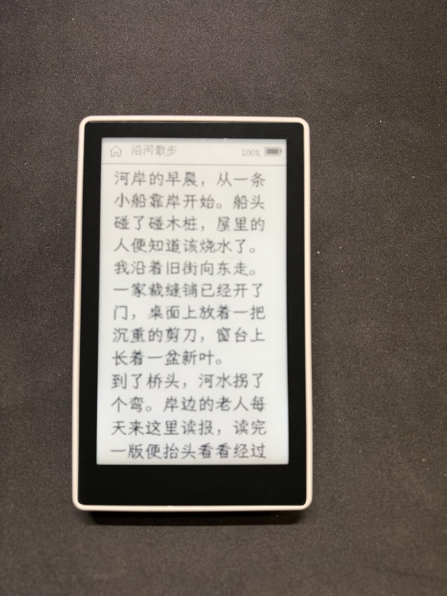</a>

*WDD 2026V1 · 静读 0.2.19 面板实拍。点图可放大查看中文笔画。*

| 想做什么 | 操作 |
| --- | --- |
| 看目录 | 阅读菜单 → 章节目录。打开时定位到当前章所在的目录页，每屏最多六条，手动翻页后保持所选页。多个标题共用一个 EPUB 分段时，优先使用已点选的条目，否则按该分段的首个标题定位。点章名进入正文。没有识别到目录时可改用进度跳转。 |
| 跳到大致位置 | 阅读菜单 → 跳转进度。每 **5%** 一档；切换选项页不会改变阅读位置，点某个百分比才跳转。菜单出现「回到跳转前」时可撤回这次跳转。 |
| 给当前页加书签 | 在**正文内**按住约 0.4 秒后向下拉，再松手；文章区域右上角出现标签。在同一页重复手势即可移除。也可在阅读菜单直接点「添加／取消本页书签」。 |
| 找回某枚书签 | 阅读菜单 → 我的书签。列表可翻页，点一条查看详情，再选「打开书签位置」或「移除此书签」。 |
| 改用左手翻页 | 正文顶边下拉 → 快捷设置 → 翻页手势，可选标准、左手或右手。顶边下拉和正文长按下拉起点不同。 |

下图来自 0.2.19 原机。测试 TXT 有 24,001 章，读到末章后点「章节目录」，直接显示第 4,001 页。点「Chapter 24001」可回到这一章。这个版本的页脚对长数字预留的宽度有限，图中总页数被裁掉，章名仍可点选。

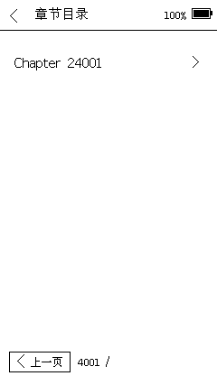

**能打开哪些书？** TXT 支持 UTF-8、GB18030，以及带 BOM 的 UTF-16/32；EPUB 主要面向无 DRM、可重排的文字书。较大的合集第一次开书要建索引，之后可复用。本机能显示部分正文内的插图，按单色显示；不承诺还原复杂版式、彩色漫画或所有图片。字号或边距改变后页数会变，阅读位置和书签以内容位置保存。

## 字体、阅读排版和屏幕刷新

<!-- views: Layout Fonts FontPrep Tools Refresh -->

进「阅读菜单 → 阅读排版」调整字号（18–30 px，每档 2 px）、行距、边距和墨色。点「正文字体」可在内置点阵与卡上的 TTF/OTF 间选择。使用卡上字体时，静读从当前阅读位置起优先准备 10 页用到的字形。当前页就绪后，最多额外等约 2 秒，也可以点「立即阅读」。开书会进入正文，更换字体会回到阅读排版。准备记录已命中时会跳过这段等待。大型 EPUB 首次建立书籍索引另需时间。

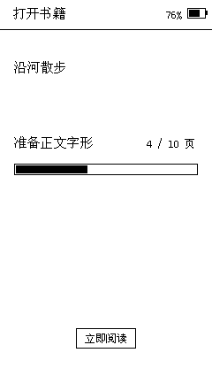

停读时先预画下一页，再补附近 100 页用到的不同字形。相同字体、字号和墨色的字形可跨书复用。

想给正文多留一行，关闭「显示阅读进度」。开启时还能选择显示全书进度或本章进度。跳转、目录和书签一直在阅读菜单里。

从已唤醒页面的顶边向下拉进入「快捷设置」，也可以从系统设置进入。点两端太阳微调前光，点中间刻度直接选 **0–10 档**。「全刷间隔」有 **5、10、20、50、100 页**，默认 10 页。残影已影响当页阅读时，点「立即清屏」即可，无需先改间隔。

| 排版：字体、字号及页脚开关 | 进度：每档 5% | 快捷设置：亮度和清屏 |
| --- | --- | --- |
| 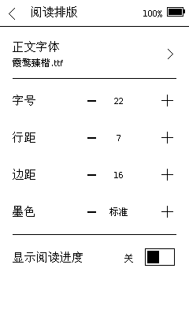 | 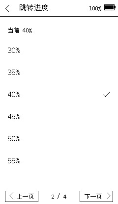 | 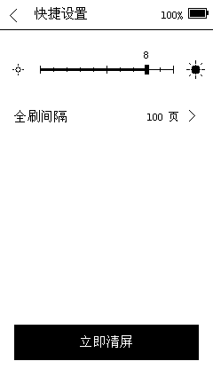 |

以上为实机回读：排版页来自 0.2.10，进度页来自 2026-11-11，快捷设置来自 0.2.1。[查看全刷五档实机画面](images/refresh.png)。

## 英语练习：读一篇，做一道，再看依据

<!-- views: Learn Courses Catalog Passage Chunks Quiz Choice Feedback -->

首页点「英语练习」。第一次从「选择课包」开始，之后可用「继续练习」回到已保存的篇目和段落。英语正文用固件内置的 **Atkinson Hyperlegible Next Medium，20 px**；切换中文书的字体不会影响它。

1. **换篇或难度。** 「选择篇目」列出当前课包里的文章，可翻页。已经进入课文时，点左下「篇目」也能换篇。OneStopQA 的初、中、高级是三个独立课包，换难度请回「选择课包」。
2. **读长短句。** 课文可跨屏；有拆句材料时会显示「逐句阅读」，用「上一句／下一句」往返。读完本段再点「理解题」。
3. **选择并核对。** 点短选项先选中；长选项先展开，读到末页点「选这一项」。只有点「核对答案」才提交，阅读选项本身不会记为答错。
4. **读反馈。** 结果页显示正确答案，以及课包提供的原文依据或解释。长反馈可翻页，末页点「重读」回原文，点「继续」进入下一段；篇末回篇目列表。

| 阅读短文 | 选中尚未提交 | 作答后看依据 |
| --- | --- | --- |
|  | 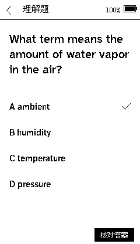 |  |

实机 0.2.1。后两图使用 SciQ 科普课包；数据作者为 Johannes Welbl、Nelson F. Liu、Matt Gardner，采用 CC BY-NC 3.0，见[资料来源及原许可](../../tf/资料来源/英语增补/使用与来源.md)。

## 离线查词、生词和错题

<!-- views: Dicts Words Definition Vocab Recall Review -->

先在「英语练习 → 我的词典」选择卡上的词典。例如选英汉看中文释义，选 WordNet 看英文释义。在**英语课文**点「查词」，再从该段词表中选词；释义较长可翻页。只有词典收录的词才有解释。点「收藏词义」把它存到本卡的生词本。

「我的生词」可做“看词忆义”：先想答案，点「显示词义」，再选「再练」或「记住了」。「错题复习」列出需要重做的题，点一项回到对应练习。日常书籍的阅读菜单没有本页查词入口。

要换材料，课包放 `/courses/english/`，词典放 `/dictionaries/词典名/`。可以直接使用随卡资料，也可导入自己的题目和兼容的 StarDict 词典。[支持的格式、CSV 列和电脑转换命令](使用与导入.md) · [词典来源与许可](../../tf/资料来源/英语增补/使用与来源.md)。

## 设置、Wi-Fi 和局域网文件服务

<!-- views: Settings Wifi Password Service -->

设置采用单屏八行：Wi-Fi、文件服务、无线墨屏、快捷设置、全刷间隔、日期与时间、电源、关于静读。阅读专用的排版留在阅读菜单，卡状态在「关于静读」内。

1. **连接 Wi-Fi。** 进入 Wi-Fi，打开无线网络；点网络名进入密码页。键盘支持大小写、数字、其他符号、空格和退格；默认遮住密码，可点「显示」核对。点「连接」，成功后返回网络列表。列表超过一屏可翻页，未看到网络可重新扫描。[试用示例密码键盘](../ui/design/index.html#pass0)。
2. **在手机或电脑配对。** 保持 TF 已挂载、两台设备处于同一局域网，在阅读器点「设置 → 文件服务 → 开启文件服务」。用浏览器打开**本机屏上**的地址，输入六位配对码。码有效五分钟，过期可在阅读器上更新。没有卡或没有网络时，页面会给出相应入口。
3. **传资料。** 网页上分别点「书籍」「字体」「英语练习」，传到 `/books`、`/fonts` 或 `/courses/english`。也可在文件管理器选择目录、新建目录、上传、下载、改名或删除。一次传一个文件，单文件上传上限 32 MiB；超过上限的资料用读卡器复制。同名不会自动覆盖，内部存档和正在使用的资源受保护。
4. **结束。** 等网页确认传输完成，再点「停止服务」。传输中停止需要确认；被中断的上传要重传。卡被移除、设备睡眠或网络断开也会结束服务。[试用离线网页文件服务](../ui/design/files.html)。

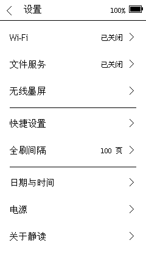

## 无线墨屏：把阅读器用作局域网显示牌

<!-- views: ScreenConnect ScreenCanvas ScreenInfo ScreenKey -->

进入「设置 → 无线墨屏」。未联网时先连接 Wi-Fi，联网后进入整屏画布。**点画布中央**查看设备地址、端口 8080 和投送密钥。发送端凭此可投送 UTF-8 文字或已经排好的 240 × 416 黑白 PBM；发送空文本清空画布。新画面替换上一屏。纯文字使用内置点阵，无 TF 卡也能显示。需要自选字体、图标或字库外字符时，从发送端排成 PBM。

在「连接信息」可重置密钥，重置后发送端也要更新；点「结束展示」回到设置。此模式只接收显示内容，不开放卡文件。[文字、图片与清屏请求示例](../formats/无线墨屏协议.md)。

## 锁屏时钟、校时、电源和设备信息

<!-- views: Lock Clock ClockEdit AutoClock Power AutoLock ConfirmLongSleep ConfirmRestart About CardInfo -->

**日常锁屏。** 双击侧键进入时钟锁屏，单击侧键唤醒。锁屏以大字显示时间，小字显示公历年月日、星期和农历，并显示电量、温度、相对湿度；没有有效时间或传感器读数时显示待校准或占位。侧键在正文中单击翻到下一页，在支持分页的列表里单击向后翻。唤醒的那次单击不会顺手翻一页。

<a href="photos/lock-clock.png">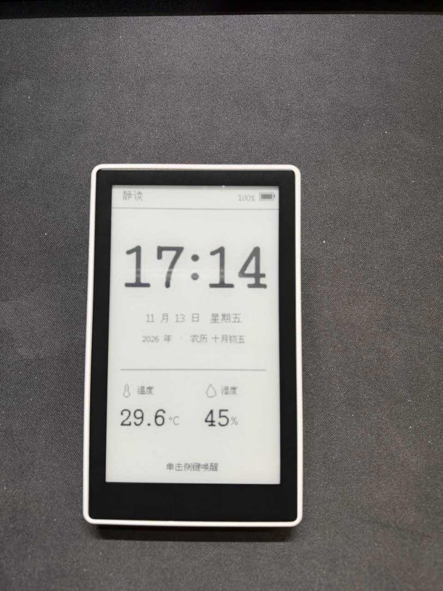</a>

*WDD 2026V1 · 静读 0.2.19 面板实拍。*

**校准时间。** 「设置 → 日期与时间」显示北京时间与农历。离线可点「手动校时」，选年、月、日、时或分，用加减调整后保存。已连接 Wi-Fi 可点「联网校时」。自动联网校时可选关闭、每天或每周；到期后，在条件允许时用已保存的网络校准，并恢复原联网状态。这个周期不保证在长期休眠中定时唤醒。

**电源。** 在「设置 → 电源」可把自动锁屏设为 5、10、15、30 分钟或关闭。短时放下设备用普通锁屏；长时间不用选「长期休眠」，确认后停止时钟刷新并关闭前光和无线，轻按一次侧键回首页。「重启设备」同样要确认，重启后回首页，保留已保存的进度和设置。

**设备与卡。** 「设置 → 关于静读」可查系统版本、设备型号、处理器、机身闪存、屏幕与分辨率。点「存储卡」查看挂载状态、重新检测；挂载后可以浏览文件。

| 自动校时 · 实机 0.2.6 | 电源 · 实机 0.2.7 | 长期休眠确认 · 实机 0.2.7 |
| --- | --- | --- |
| 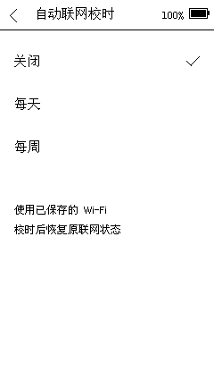 | 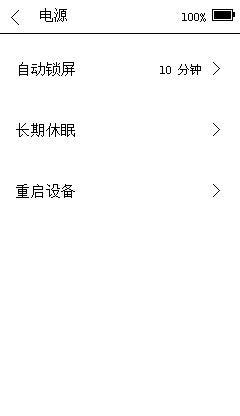 |  |

## 保留什么，以及操作没成功时怎么办

<!-- views: Message -->

- **换卡或备份。** 保存原书、课包、词典及 `/.jingdu/user/`，并保留原目录和文件名。书架、最近阅读、位置、书签和学习记录均随卡；Wi-Fi 凭据及部分设备设置在机身，不会随空白卡清除。
- **清缓存。** 退出阅读并停止文件服务后，才在读卡器上清理 `/.jingdu/cache/`；固件可以重建它，下次打开可能变慢。不要把 `user` 当缓存删除。[目录和备份清单](../formats/TF卡目录与文件.md)。
- **没有找到卡、书或字体。** 按提示重新检测卡；书若移动，先从新位置打开或重新收录；字体打不开，可重新选择兼容字体或内置点阵。更换过同名书时，按版本变化提示决定如何继续，旧版本的进度和书签保留。
- **大型 EPUB 无法打开。** 先辨认提示是卡读写、文件格式、索引上限还是当时可用内存不足。退出其他占用资源的功能有时有帮助；超过索引能力不能靠重试解决。这台设备优先服务文字阅读。[当前索引边界](../architecture/阅读流水线与资源.md)。
